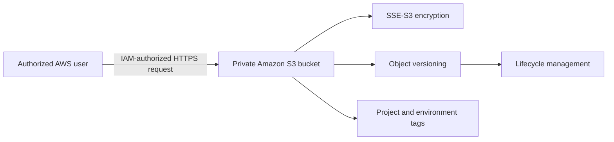

# AWS Secure S3 Document Vault

A beginner-friendly AWS portfolio project demonstrating how to create and manage a secure Amazon S3 document vault.

## Project Overview

This project stores documents in a private S3 bucket and applies practical security and data-protection controls. It was built using the AWS Management Console in the `us-east-1` Region.

## Architecture



## Implemented Features

- Blocked all public access
- Disabled ACLs with Bucket owner enforced
- Enabled server-side encryption with Amazon S3 managed keys (SSE-S3)
- Enabled bucket versioning
- Tested object version recovery by uploading two versions of `day1.txt`
- Added project and environment tags
- Added a lifecycle rule to delete noncurrent object versions after 30 days
- Created the `documents/` prefix and uploaded a sample project description

## Security Decisions

- The bucket is private and does not host a public website.
- ACLs are disabled so access is controlled with IAM and bucket policies.
- Encryption at rest is enabled by default.
- Versioning provides recovery from accidental overwrite or deletion.
- No access keys, passwords, account IDs, or unredacted console screenshots are stored in this repository.

## Verification Performed

1. Confirmed Block Public Access is enabled.
2. Confirmed default encryption is SSE-S3.
3. Confirmed versioning is enabled.
4. Uploaded a second version of `day1.txt` and verified both version IDs.
5. Confirmed the lifecycle rule is active.
6. Confirmed the sample document is stored under `documents/`.

## Repository Structure

```text
.
├── README.md
├── docs/
│   └── architecture.md
├── assets/
│   └── README.md
└── sample-files/
    ├── day1.txt
    └── project-description.txt
```

## Interview Explanation

> I created a private S3 document vault with public access blocked, ACLs disabled, default SSE-S3 encryption, versioning, tagging, and lifecycle management. I tested versioning by uploading two versions of the same object and configured noncurrent versions to expire after 30 days. This project taught me how S3 security, recovery, and cost controls work together.

## Future Improvements

- Rebuild the project using Terraform
- Use a customer-managed AWS KMS key where stronger key control is required
- Add CloudTrail data events and access logging
- Add automated security checks in a CI/CD pipeline
- Add a least-privilege IAM role for application access

## Cost Management

The bucket contains only small training files. Lifecycle management helps prevent old versions from accumulating indefinitely. Resources should be reviewed and deleted when no longer needed.

## Important Note

Amazon S3 uses object key prefixes rather than traditional folders. The `documents/` folder shown in the console is a prefix in the object key.
