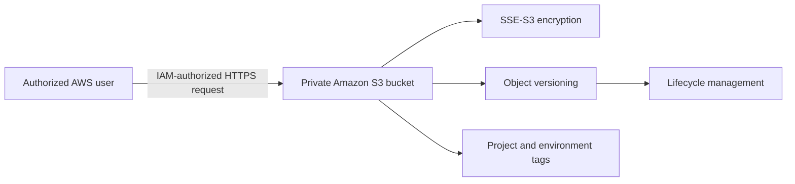

# AWS Secure S3 Document Vault

Secure document storage on Amazon S3

A beginner-friendly AWS portfolio project demonstrating how to create and manage a secure Amazon S3 document vault.

## What this project does

This project stores documents in a private S3 bucket and applies practical security and data-protection controls. It was built using the AWS Management Console in the `us-east-1` Region.

## Architecture / How it works



An authorized AWS user reaches the private S3 bucket over an IAM-authorized HTTPS request. Objects are encrypted with SSE-S3, versioning keeps earlier versions, a lifecycle rule cleans up noncurrent versions, and project and environment tags identify the bucket. Further detail is in `docs/architecture.md`.

## Tech stack


## Repository structure

```text
.
├── README.md
├── docs/
│   └── architecture.md
├── assets/
│   └── README.md
├── evidence/
│   └── README.md
└── sample-files/
    ├── day1.txt
    └── project-description.txt
```

`evidence/` holds guidance for adding only redacted screenshots; no unredacted console screenshots are stored in this repository.

## Key work demonstrated

- Created a private S3 bucket with Block Public Access enabled and ACLs disabled (Bucket owner enforced).
- Enabled default server-side encryption with Amazon S3 managed keys (SSE-S3) and bucket versioning.
- Tested version recovery by uploading two versions of `day1.txt` and verifying both version IDs.
- Added a lifecycle rule to delete noncurrent object versions after 30 days.
- Organized uploads under the `documents/` prefix, with a sample project description stored there.

## Implemented Features

- Blocked all public access
- Disabled ACLs with Bucket owner enforced
- Enabled server-side encryption with Amazon S3 managed keys (SSE-S3)
- Enabled bucket versioning
- Tested object version recovery by uploading two versions of `day1.txt`
- Added project and environment tags
- Added a lifecycle rule to delete noncurrent object versions after 30 days
- Created the `documents/` prefix and uploaded a sample project description

## Security Decisions

- The bucket is private and does not host a public website.
- ACLs are disabled so access is controlled with IAM and bucket policies.
- Encryption at rest is enabled by default.
- Versioning provides recovery from accidental overwrite or deletion.
- No access keys, passwords, account IDs, or unredacted console screenshots are stored in this repository.

## Verification Performed

1. Confirmed Block Public Access is enabled.
2. Confirmed default encryption is SSE-S3.
3. Confirmed versioning is enabled.
4. Uploaded a second version of `day1.txt` and verified both version IDs.
5. Confirmed the lifecycle rule is active.
6. Confirmed the sample document is stored under `documents/`.

## Interview Explanation

> I created a private S3 document vault with public access blocked, ACLs disabled, default SSE-S3 encryption, versioning, and a lifecycle rule. I verified the settings through the AWS Console and tested recovery by uploading two versions of a file. The project focuses on secure defaults and evidence-based verification.

## Future Improvements

- Add Terraform configuration to provision the bucket and controls.
- Add an IAM policy example with least-privilege permissions.
- Add a lifecycle rule for moving older data to Amazon S3 Glacier.
- Add AWS CloudTrail and Amazon S3 server access logging.
- Add a private access pattern using Amazon VPC endpoints.

## Cost Considerations

- Amazon S3 charges are based on storage usage.
- This project uses small sample files and is expected to remain within the AWS Free Tier.
- Deleting the bucket or objects after use avoids further charges.

## Important Note

This project is a learning portfolio and does not contain production credentials, real customer documents, or sensitive account information.
