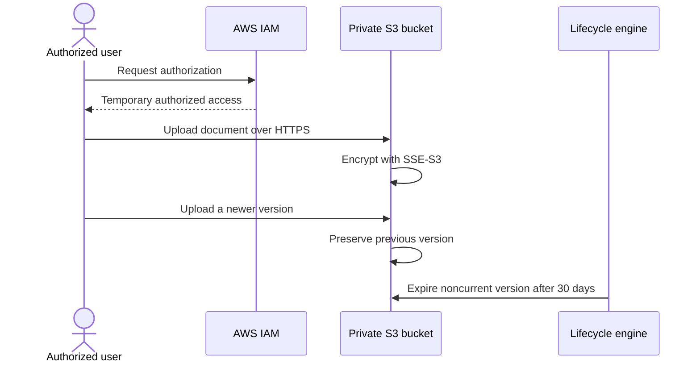

# Architecture and Data Flow

## Data Flow

1. An authorized AWS identity requests access to an S3 object over HTTPS.
2. IAM and bucket policies determine whether the request is allowed.
3. Amazon S3 stores the object using SSE-S3 encryption.
4. Versioning preserves older object versions after an overwrite.
5. The lifecycle rule removes noncurrent versions after 30 days.

## Controls Used

| Area | Control | Purpose |
|---|---|---|
| Access | Block Public Access | Prevent accidental public exposure |
| Ownership | Bucket owner enforced | Disable ACL-based access |
| Encryption | SSE-S3 | Encrypt objects at rest |
| Recovery | Versioning | Recover overwritten or deleted objects |
| Cost | Lifecycle rule | Remove old noncurrent versions |
| Organization | Tags | Identify project and environment |
